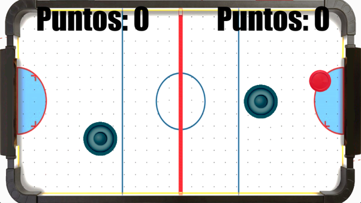

# 
 AIR HOCKEY

The game is an air hockey table with a puck that starts already in motion, where both players move their mallets to hit the puck.

Your objective is to score goals by bouncing the puck into the opponent’s goal and earn more points than your rival. The only rule is that you cannot cross the halfway line into the opponent’s side of the field, which is marked by a red line.

If the puck bounces off your own mallet and enters your goal, the goal still counts, and the opponent will be awarded one point.

     
    

